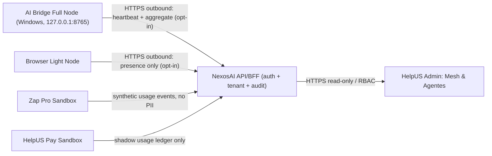

# ADR-020 — NexosAI Cloud Mesh como plano de controle HelpUS (Draft)

**Data:** 2026-10-31  
**Status:** PROPOSED — architecture-only, not approved for implementation/deployment  
**Issue:** https://github.com/HelpUSA/hub/issues/10  
**Input:** HU-HUB-STRATEGY-NEXOSAI-INTEGRATION-20261031-020  
**Stakeholders:** ChatGPT (arquitetura e GitHub), Antigravity (Windows e QA), Master SuperAdmin (autorização).

## 1. Decisão proposta

Separar **plano de controle** (NexosAI Cloud), **plano de execução local** (AI Bridge Full Node / Light Node) e **visualização central** (HelpUS Admin), mantendo Zap Pro e Pay como sistemas de origem, sem compartilhamento de estados operacionais por escrita direta em tabelas de outros serviços.

**Não permitido:** NexosAI, Admin ou outro serviço na nuvem conectar-se diretamente a `127.0.0.1:8765` (loopback remoto não é o loopback do Windows), abrir túnel reverso, executar shell/filesystem remoto, ler segredos do nó, consumir conteúdo de WhatsApp real, cobrir valores financeiros reais ou realizar deploy por implicação.

## 2. Evidência inspecionada no GitHub
- `HelpUSA/nexosai`, `prisma/schema.prisma`: modelos Organization, User, Node, Agent, Conversation, Message, Document, Embedding e AuditLog, relações org/tenant. Um **schema** não comprova rotas REST, enforcement de RBAC, jobs de heartbeat nem integração real.
- `HelpUSA/nexosai/src/app/nodes/page.tsx`: array literal de nós e status de apresentação; `src/app/admin/page.tsx`: painel descritivo estático.
- `HelpUSA/helpus-admin/src/App.tsx`: subdomínios, métricas e leads modelados em arrays/estados locais, inclusive NexosAI; aparência ONLINE e latências **não são evidência de health real**.
- Antigravity relatou NexosAI no host `D:\AntiG\nexosai` e gateway `127.0.0.1:8765`, além do Admin em `D:\AntiG\helpus-admin`. Versão e diffs do host exigem relatório independente e sanitizado. Não modificar workspace local nesta etapa.
- `HelpUSA/helpus-auth` Draft PR #1 é autoridade JWT **somente de laboratório**, não identidade corporativa operacional. `HelpUSA/helpus-pay` PR #4 e `helpus-whatsapp-ia` PR #3 são G3-B+ testes sandbox. Jamais tratá-los como backend produtivo de billing.

## 3. Bounded contexts

| Contexto | Proprietário dos dados | Publica | Consome | Limite |
| --- | --- | --- | --- | --- |
| Node Registry/Presence | NexosAI | NodePresence.v1 | NodeHeartbeat.v1 | Heartbeat com TTL; sem comando arbitrário |
| Agent Catalog | NexosAI | AgentSummary.v1 | AgentConfigurationRequest (futuro, revisão separada) | Acesso condicionado a organização/role |
| Observability | NexosAI | UsageAggregate.v1 | SyntheticUsageEvent.v1 | Sem texto, telefone, tokens brutos de usuário |
| Chat/Commerce | Zap Pro | SyntheticConversationUsage.v1 | Nenhum comando cloud | Fonte canônica da conversa permanece Zap Pro |
| Shadow Ledger | Pay (futuro) | SyntheticUsageLedger.v1 | UsageAggregate.v1 | Sem captura, PIX, refund, faturamento ou PSP |
| Admin UI | HelpUS Admin | Nenhum | NodePresence/UsageAggregate read-only | Jamais lê DB/Nexos local diretamente |

## 4. Identidade, organização e autorização

1. `organizationId` **derivado do contexto autenticado/relationship service**, jamais confiar no valor enviado pelo cliente em filtros, query strings ou eventos para autorização.
2. RBAC mínimo: `ADMIN` (superadmin auditado), `OWNER` (organização), `OPERATOR` (leitura operacional), `VIEWER` (leitura somente). Nenhuma role implica automaticamente operação em node local.
3. Mínimo necessário de credenciais: tokens de nó curtos, com `aud=nexosai-mesh-ingest`, `sub=node:<id>`, `org`, `scope=mesh:heartbeat`; rotação, revogação, nonce/idempotência e prova de posse devem ser definidos antes de conexão real.
4. No MVP de laboratório, usar **fixtures criptograficamente assinadas** com chave aleatória gerada no teste; nenhuma chave real, segredo de API ou token persistente no Git.
5. Verificar isolamento de mensagens/Document/Embedding e AuditLog por `organizationId` **inclusive por joins indiretos** (Message → Conversation, Embedding → Document). Não presumir RLS sem migração e testes.
6. Nunca renderizar `systemPrompt` integral, embeddings brutos, `externalId` de WhatsApp, `Message.content`, `installPath`, `machineName` ou `ipAddress` no Admin sem base legal/política específica.

## 5. Presença e consistência

- Heartbeat sintético é evento observável, não ordem de execução. Frequência proposta **30s**, TTL de frescor **90s** após evento autenticado e com relógio controlado; clock skew tolerado **60s**. Números sujeitos a medição e revisão.
- `ONLINE` = heartbeat válido dentro do TTL + `gatewayOk` e `runtimeReady`; `DEGRADED` = heartbeat válido com flag negativa; `STALE` = último heartbeat fora do TTL; `UNKNOWN` = dados ausentes, não confiáveis ou API indisponível. `OFFLINE` apenas por evento verificado/expiração definida no protocolo, nunca por ausência momentânea de resposta da UI.
- UI sempre mostra `observedAt`, `receivedAt`, `dataSource=DEMO|LAB|LIVE` e `lastUpdated`. Valores estáticos devem estar inequivocamente marcados DEMO.
- Escrever heartbeat com `eventId` único, aceitar replay idempotente do mesmo payload, rejeitar colisão (mesma chave, payload diferente); nunca permitir eventos de outros tenants.

## 6. Privacidade e retenção (política inicial para revisão)

- Fase N0/N1: **zero ingestão de PII**, telefones, IPs, conteúdo de WhatsApp, arquivos, chats, prompts e RAG real; apenas nomes sintéticos e contadores simulados.
- Agregação por intervalo `windowStart/windowEnd`; hash estável do evento *não* deve permitir reversão/identificação de pessoa. Documentar finalidade, período de retenção e exclusão antes de dados reais.
- Consumo e tokens: `tokensUsed`/latência são medições operacionais, **não cobrança monetária**. Rateio, créditos e billing exigem outra decisão, autorização e contrato.
- Cuidado com `AuditLog.details`: nunca registrar segredos/tokens/payloads brutos. Registro resumido de resultado, actor, resource e `correlationId` por tenant.

## 7. Opções rejeitadas nesta fase

- **Acesso cloud direto ao gateway Windows**: expõe máquina e ignora loopback/NAT; não usar túnel por padrão.
- **Share direto de tabelas Prisma entre apps**: acopla migrations, ameaça isolamento e ownership; preferir API/eventos.
- **Admin como gestor direto de chaves/nós**: escopo excessivo e elevação de privilégio; somente BFF read-only.
- **Espelhamento de conversas WhatsApp**: PII/LGPD desnecessária para métricas; somente agregados sintéticos.
- **Cobrança baseada no uso já neste MVP**: exige verificação de contabilização, reconciliação bancária e governança financeira indisponíveis no sandbox.

## 8. Gates e aceitação

| Gate | Entrega | Owner | Saída |
| --- | --- | --- | --- |
| N0 | Inventário GitHub/Windows, ADR + contratos + threat model + runbook | ChatGPT / Antigravity | Draft reviewed |
| N1 | Fixtures e validador NodeHeartbeat/UsageAggregate com testes de escopo e replay | ChatGPT (PR Draft futuro) | Synthetic CI Green |
| N2 | Design/protótipo Admin somente leitura com `DEMO/LAB/LIVE`, `UNKNOWN` | ChatGPT e Antigravity | Sandbox UI QA |
| N3 | Eventos sintéticos Zap Pro + shadow ledger Pay, sem cobrança | ChatGPT / Antigravity | CI cross-repo e Windows |
| N4 | Review de isolamento, LGPD, threat model, HA, rollback, SLO, autorização | Auditor independente + usuário | Decisão futura, não tácita |

**Aceite deste ADR:** PR Draft + Issue; assinatura de contratos *não* equivale a autorização de deploy, ingestão real, comunicação com gateway Windows ou G3-C do Zap Pro.

**Estado:** `NEXOSAI_MESH_ARCHITECTURE_DRAFT_ONLY`. Mantido `G3B_APPROVED_SANDBOX_ONLY` e `G3C_NOT_AUTHORIZED`.
