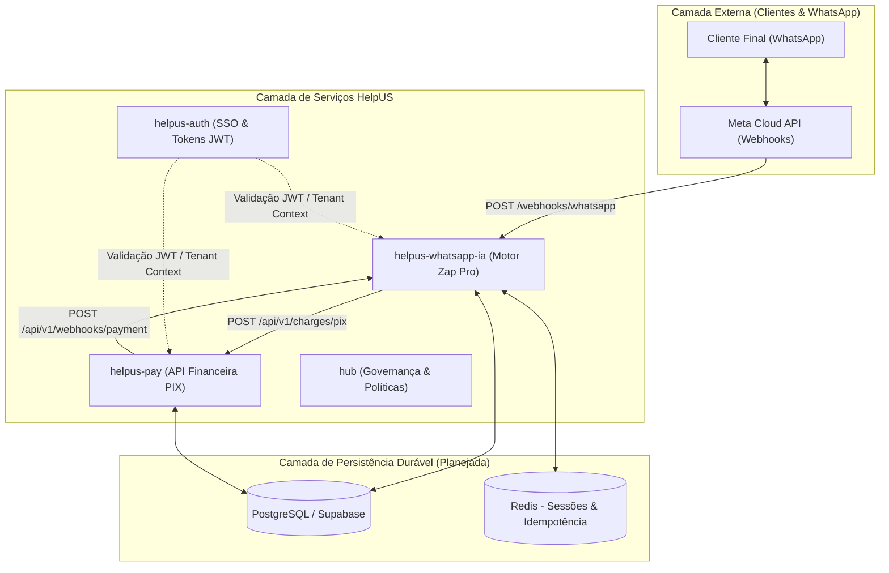
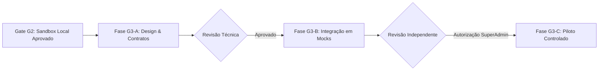

# Plano de Preparação Arquitetural e Técnica — Gate G3 (Zap Pro)

**Data de Elaboração:** 31 de Outubro de 2026  
**Status do Gate:** `G3_PLANNING_ONLY` (Planejamento Documental — Execução Operacional Bloqueada)  
**Referência de Governança:** [HUB Issue #9](https://github.com/HelpUSA/hub/issues/9)  
**Origem do Gate:** [HUB Issue #8](https://github.com/HelpUSA/hub/issues/8) — Homologação restrita `G2_APPROVED_SANDBOX_ONLY`  
**Escopo Autorizado:** Levantamento técnico somente-leitura, diagramas, contratos OpenAPI, modelagem de dados e riscos.

---

## 1. Inventário Arquitetural AS-IS vs. TO-BE

### 1.1. Arquitetura Atual (AS-IS — Homologada no Gate G2)
* **`helpus-whatsapp-ia` (PR #1 - Commit `9f9c8ba`)**:
  - Motor em Node.js com máquina de estados de sessão (`SessionOrchestrator`) e adaptador Meta Cloud API (`WhatsAppAdapter`).
  - **Isolamento**: Contém um serviço de mock em memória (`PaymentMockService`) dentro do próprio processo.
  - **Servidor HTTP Sandbox**: Implementado em `sandbox/server_sandbox.js` recebendo requisições em porta efêmera com validação HMAC.
  - **Testes**: 19 testes automatizados aprovados no CI (15 unitários/invariantes + 4 HTTP E2E).
* **`helpus-pay` (PR #2 - Commit `5dde902`)**:
  - Aplicação frontend React + Vite com endpoints serverless em `api/sandbox/pix_service.ts`.
  - **Isolamento**: Motor mock de geração de PIX com validações financeiras e verificação HMAC de 64 caracteres hexadecimais.
  - **CI**: Executado com `tsx` e `tsc --noEmit` estrito no Node 22 (4/4 testes aprovados).
* **`helpus-auth`**:
  - Portal SPA React + Vite em `D:\AntiG\helpus-auth` contendo telas de autenticação e catálogo de destinos SSO.
* **`hub`**:
  - Repositório central de governança, documentação estratégica e gestão de Quality Gates.
* **Ponto Crítico AS-IS**: Não existe qualquer chamada HTTP de rede entre `helpus-whatsapp-ia` e `helpus-pay`. Toda a integração E2E do G2 foi testada usando o mock interno local.

### 1.2. Arquitetura Proposta (TO-BE — Preparação para Gate G3)


---

## 2. Especificação OpenAPI Proposta (Contrato Cross-Service)

Abaixo o contrato padronizado OpenAPI 3.1 para a comunicação HTTP entre `helpus-whatsapp-ia` (consumidor) e `helpus-pay` (provedor financeiro):

```yaml
openapi: 3.1.0
info:
  title: HelpUS Pay - PIX Gateway Internal API
  version: 1.0.0-draft.g3
  description: Contrato interno cross-service para geração e conciliação de cobranças PIX multi-tenant.
paths:
  /api/v1/charges/pix:
    post:
      summary: Criação de Cobrança PIX
      description: Requisitado pelo motor WhatsApp para gerar chave copia-e-cola e QR Code com TTL de 15 minutos.
      headers:
        X-Tenant-Id:
          schema: { type: string }
          required: true
        X-Idempotency-Key:
          schema: { type: string, format: uuid }
          required: true
        Authorization:
          schema: { type: string, example: "Bearer eyJhbG..." }
          required: true
      requestBody:
        required: true
        content:
          application/json:
            schema:
              type: object
              required: [orderId, amount, customerPhone]
              properties:
                orderId: { type: string, example: "ord_1730389000_123" }
                amount: { type: number, minimum: 0.01, maximum: 10000.00, example: 70.00 }
                customerPhone: { type: string, pattern: "^[0-9]{10,15}$", example: "5583999990000" }
      responses:
        '201':
          description: Cobrança criada com sucesso.
          content:
            application/json:
              schema:
                type: object
                required: [txid, status, amount, pixCopiaECola, expiresAt]
                properties:
                  txid: { type: string, example: "tx_pix_987654321" }
                  status: { type: string, enum: [PENDING] }
                  amount: { type: number, example: 70.00 }
                  pixCopiaECola: { type: string }
                  qrCodeUrl: { type: string, format: uri }
                  expiresAt: { type: string, format: date-time }
        '400': { description: Parâmetros inválidos ou violação de finitude de valores. }
        '401': { description: Token de serviço inválido ou expirado. }
        '409': { description: Chave de idempotência em conflito com payload divergente. }

  /api/v1/charges/pix/{txid}/cancel:
    post:
      summary: Cancelamento Atômico de Cobrança
      parameters:
        - name: txid
          in: path
          required: true
          schema: { type: string }
      responses:
        '200':
          content:
            application/json:
              schema:
                type: object
                properties:
                  txid: { type: string }
                  status: { type: string, enum: [CANCELLED] }
                  cancelledAt: { type: string, format: date-time }

  /api/v1/webhooks/payment:
    post:
      summary: Callback Assíncrono de Liquidação PIX
      description: Disparado pelo HelpUS Pay para o webhook do motor WhatsApp após confirmação bancária.
      headers:
        X-Signature-SHA256:
          schema: { type: string, pattern: "^[0-9a-fA-F]{64}$" }
          required: true
      requestBody:
        required: true
        content:
          application/json:
            schema:
              type: object
              required: [event, eventId, timestamp, data]
              properties:
                event: { type: string, enum: [PIX_RECEIVED] }
                eventId: { type: string, example: "evt_1730389500_abc" }
                timestamp: { type: string, format: date-time }
                data:
                  type: object
                  required: [txid, orderId, tenantId, amount, status, paidAt]
                  properties:
                    txid: { type: string }
                    orderId: { type: string }
                    tenantId: { type: string }
                    amount: { type: number }
                    status: { type: string, enum: [PAID] }
                    paidAt: { type: string, format: date-time }
      responses:
        '200': { description: Webhook processado e pedido liquidado com sucesso. }
        '400': { description: Pedido cancelado, expirado ou divergência de inquilino. }
        '401': { description: Assinatura HMAC inválida ou adulterada. }
```

---

## 3. Modelo de Autorização Multi-Tenant e Prevenção de IDOR

1. **Derivação de Identidade no Servidor**:
   - O `tenantId` nunca deve ser aceito como parâmetro confiável a partir da mensagem do WhatsApp do usuário final.
   - O motor mapeia o campo `entry[].changes[].value.metadata.phone_number_id` (assinado pela Meta) contra a tabela `tenants` para derivar o `tenantId` de forma criptograficamente segura.
2. **Matriz de Permissões RBAC**:
   - `SUPER_ADMIN`: Acesso irrestrito a configurações globais e telemetria.
   - `TENANT_ADMIN`: Acesso restrito ao catálogo, operadores e relatórios do próprio `tenantId`.
   - `TENANT_OPERATOR`: Permissão para receber handoff humano e enviar mensagens de atendimento dentro do seu tenant.
   - `CUSTOMER`: Sessão efêmera baseada em número de telefone (`customerPhone`) e consentimento ativo.
3. **Prevenção Estrita de IDOR (Insecure Direct Object Reference)**:
   - Toda consulta no banco de dados DEVE conter cláusula composta obrigatória:
     `SELECT * FROM orders WHERE id = :orderId AND tenant_id = :derivedTenantId`
   - Tentativas de liquidar, cancelar ou consultar pedidos pertencentes a outro tenant disparam evento de segurança `SECURITY_IDOR_VIOLATION` com bloqueio imediato da requisição.

---

## 4. Persistência Durável e Consistência Transacional

### 4.1. Esquema Relacional de Dados Proposto
* **`tenants`**: `id` (PK), `name`, `meta_phone_number_id` (Unique), `status`, `created_at`.
* **`sessions`**: `id` (PK), `tenant_id` (FK), `customer_phone`, `state`, `active_order_id`, `consent_given_at`, `updated_at`.
* **`orders`**: `id` (PK), `tenant_id` (FK), `customer_phone`, `status` (`WAITING_PAYMENT`, `PAID`, `CANCELLED`, `EXPIRED`), `total_amount`, `txid` (Unique), `created_at`, `paid_at`.
* **`charges`**: `txid` (PK), `tenant_id` (FK), `order_id` (FK), `amount`, `status`, `expires_at`, `paid_at`.
* **`webhook_events`**: `event_id` (PK), `source`, `payload_sha256`, `processed_at`, `idempotent_result`.

### 4.2. Protocolo de Transação Atômica de Liquidação
```sql
-- Transação Atômica no Banco de Dados ao Processar Callback PIX
BEGIN TRANSACTION;

-- 1. Deduplicação e Idempotência
INSERT INTO webhook_events (event_id, source, payload_sha256, processed_at)
VALUES (:eventId, 'helpus-pay', :hash, NOW())
ON CONFLICT (event_id) DO NOTHING;

-- Se o evento já foi processado anteriormente, aborta com sucesso idempotente
-- (Idempotent replay protection)

-- 2. Lock Pessimista no Pedido e Cobrança
SELECT status FROM orders WHERE id = :orderId AND tenant_id = :tenantId FOR UPDATE;
SELECT status FROM charges WHERE txid = :txid AND tenant_id = :tenantId FOR UPDATE;

-- 3. Guard de Invariante: Bloqueio de liquidação de pedidos cancelados/expirados
IF order.status IN ('CANCELLED', 'EXPIRED') THEN
    ROLLBACK;
    RAISE EXCEPTION 'CANNOT_PAY_CANCELLED_OR_EXPIRED_ORDER';
END IF;

-- 4. Transição Atômica Conjunta
UPDATE charges SET status = 'PAID', paid_at = :paidAt WHERE txid = :txid;
UPDATE orders SET status = 'PAID', paid_at = :paidAt WHERE id = :orderId;
UPDATE sessions SET state = 'PEDIDO_PAGO', active_order_id = NULL WHERE tenant_id = :tenantId AND customer_phone = :phone;

COMMIT;
```

---

## 5. Threat Model STRIDE, LGPD e Políticas Meta

### 5.1. Threat Model (STRIDE)
| Ameaça | Vetor de Risco | Mitigação Arquitetural G3 |
| :--- | :--- | :--- |
| **Spoofing** | Requisição forjada se passando por webhook bancário ou Meta | Validação obrigatória de HMAC-SHA256 (`x-hub-signature-256` e `x-signature-sha256`) com `timingSafeEqual`. |
| **Tampering** | Cliente injeta preço inferior ou quantidade fraudulenta no chat | Cálculo de valor 100% no servidor (`TenantManager`), limites de 1 a 50 itens e teto financeiro de R$ 10.000,00. |
| **Repudiation** | Cliente afirma ter pago mas o sistema não registrou | Registro de auditoria imutável em `webhook_events` contendo `endToEndId` bancário oficial do BACEN. |
| **Information Disclosure** | Vazamento de dados pessoais de clientes de um inquilino para outro | Isolamento multi-tenant por cláusula de banco, ofuscação de números em logs (`5583****1234`). |
| **Denial of Service** | Inundação de webhooks ou mensagens em loop | Rate limiting por IP e por telefone (máx. 60 requisições/minuto), timeout de 10s e body cap de 64KB. |
| **Elevation of Privilege** | Atendente tenta acessar dados de outro inquilino | Token JWT emitido pelo `helpus-auth` contendo escopo estrito `tenant_id` assinado digitalmente. |

### 5.2. Conformidade LGPD & Políticas Oficiais da Meta
* **Consentimento Prévio Obrigatório**: O bot não coleta pedidos sem o opt-in explícito do usuário no estado `TRIAGEM` (resposta "SIM").
* **Direito ao Cancelamento e Esquecimento**: Comando global "cancelar" apaga carrinhos pendentes e interrompe fluxos ativos.
* **Janela de Atendimento de 24 Horas**: Mensagens de marketing só podem ser enviadas dentro da janela de 24h aberta pelo usuário ou através de Message Templates aprovados pela Meta.
* **Módulo de Voz (TTS)**: Marcado como opcional na arquitetura G3 até licenciamento e autorização expressa do Master SuperAdmin.

---

## 6. Matriz de Testes Futuros e Critérios GO/NO-GO para o Piloto

### 6.1. Matriz de Cenários Negativos Cruzados
1. **Divergência Multi-Tenant**: Tenant B tenta liquidar cobrança de Tenant A $\rightarrow$ `400 Bad Request / CROSS_TENANT_VIOLATION`.
2. **Corrida Concorrente (Race Condition)**: Cliente cancela pedido no mesmo milissegundo em que o webhook bancário bate $\rightarrow$ Pedido permanece `CANCELLED`, cobrança não vira `PAID`.
3. **Replay de Webhook**: Reenvio de payload idêntico 100 vezes $\rightarrow$ Processado 1 vez, 99 respostas idempotentes sem alteração de saldo.
4. **Assinatura Malformada**: Assinatura com comprimento incorreto, caracteres especiais ou não-hexadecimais $\rightarrow$ Rejeição silenciosa `401 Unauthorized` sem crash.
5. **Simulação de Crash/Restart**: Derrubar o servidor enquanto a sessão está em `AGUARDANDO_PIX` $\rightarrow$ Ao reiniciar, restaurar estado exato a partir do banco durável.

### 6.2. Critérios Objetivos GO/NO-GO para o Piloto Controlado
* **Critérios GO (Avanço autorizado para Piloto)**:
  - [ ] Contratos OpenAPI implementados e validados por ferramentas de contrato.
  - [ ] 100% dos testes unitários, de invariantes e de integração HTTP aprovados nos 4 repositórios.
  - [ ] Banco de dados relacional configurado com transações atômicas e migrações versionadas.
  - [ ] Número de telefone de homologação oficial verificado na Meta Cloud API.
  - [ ] Termo formal de aprovação assinado pela autoridade Master SuperAdmin.
* **Critérios NO-GO (Bloqueio Imediato)**:
  - Qualquer falha de isolamento multi-tenant detectada em testes de estresse.
  - Qualquer mutação de estado de pedido para `PEDIDO_PAGO` sem validação bancária.
  - Ausência de assinatura HMAC válida em qualquer endpoint público.

---

## 7. Cronograma Faseado Proposto (G3-A, G3-B, G3-C)



1. **Fase G3-A: Especificação e Design de Dados (Estimativa: 2 a 3 dias úteis)**:
   - Conclusão das especificações OpenAPI v3.1 sanitizadas.
   - Modelagem de esquemas SQL e migrações Prisma/Drizzle.
   - Revisão documental e submissão à governança.
2. **Fase G3-B: Integração Local em Mocks sob Nova Autorização (Estimativa: 3 a 5 dias úteis)**:
   - Subir instâncias locais de `helpus-whatsapp-ia` e `helpus-pay` comunicando-se via HTTP em loopback.
   - Validar contratos de cobrança e cancelamento entre serviços separados.
   - Zero operações financeiras reais.
3. **Fase G3-C: Piloto Controlado sob Aprovação Expressa (Estimativa: 5 a 7 dias úteis)**:
   - Configuração de 1 tenant piloto (Studio Navalha & Arte).
   - Teste controlado em ambiente restrito com auditoria humana em tempo real.

---

## 8. Diagnóstico de Higiene Git no Repositório Privado `helpus-whatsapp-ia`

* **Diagnóstico AS-IS**:
  - Consulta ao GitHub API: `"defaultBranchRef": {"name": "feat/zap-pro-sandbox-engine-20261031"}`.
  - A branch de feature se tornou a branch padrão do repositório no momento do primeiro push.
* **Ajuste Técnico Proposto (para ser executado apenas sob autorização)**:
  1. Criar e sincronizar a branch `main` com o histórico limpo e aprovado.
  2. Executar via GitHub CLI: `gh repo edit HelpUSA/helpus-whatsapp-ia --default-branch main`.
  3. Aplicar regra de proteção de branch em `main` exigindo PR com revisão aprovada e CI verde antes do merge.
  4. Manter o PR #1 em estado Draft até o fechamento completo do ciclo G3.
