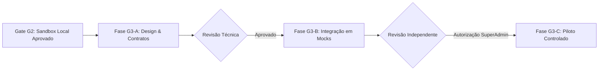

# Plano de Preparação Arquitetural e Técnica — Gate G3 (Zap Pro)

**Data de Elaboração:** 31 de Outubro de 2026  
**Status do Gate:** `G3_PLANNING_ONLY` (Planejamento Documental — Execução Operacional Bloqueada)  
**Referência de Governança:** [HUB Issue #9](https://github.com/HelpUSA/hub/issues/9)  
**Origem do Gate:** [HUB Issue #8](https://github.com/HelpUSA/hub/issues/8) — Homologação restrita `G2_APPROVED_SANDBOX_ONLY`  
**Escopo Autorizado:** Levantamento técnico somente-leitura, diagramas, contratos OpenAPI, modelagem de dados, matrizes de risco/RBAC e hygiene Git.  
**Limites Estritos:** Sem merges, sem deploys em produção, sem provisionamento de infraestrutura real, sem números reais de WhatsApp e sem transações bancárias/PIX reais.

---

## 1. Inventário Arquitetural AS-IS vs. TO-BE

### 1.1. Arquitetura Atual (AS-IS — Homologada no Gate G2)
* **`helpus-whatsapp-ia` (PR #1 - Commit `9f9c8ba`)**:
  - Motor em Node.js com máquina de estados de sessão (`SessionOrchestrator`) e adaptador Meta Cloud API (`WhatsAppAdapter`).
  - **Isolamento**: Contém um serviço de mock em memória (`PaymentMockService`) dentro do próprio processo.
  - **Servidor HTTP Sandbox**: Implementado em `sandbox/server_sandbox.js` recebendo requisições em porta efêmera com validação HMAC (`x-signature-sha256`).
  - **Cancelamento Atômico**: Sincronização entre pedido e cobrança via `paymentService.cancelCharge(order.txid)`.
  - **Testes**: 19 testes automatizados aprovados no CI (15 unitários/invariantes + 4 HTTP E2E).
* **`helpus-pay` (PR #2 - Commit `5dde902`)**:
  - Aplicação frontend React + Vite com endpoints serverless em `api/sandbox/pix_service.ts`.
  - **Isolamento**: Motor mock de geração de PIX com validações financeiras e verificação HMAC de 64 caracteres hexadecimais.
  - **CI**: Executado com `tsx` e `tsc --noEmit` estrito no Node 22 (4/4 testes aprovados).
* **`helpus-auth`**:
  - Portal SPA React + Vite em `D:\AntiG\helpus-auth` contendo telas de autenticação e catálogo de destinos SSO.
  - **Lacuna Técnica Crítica**: É estritamente uma aplicação frontend (client-side) e **NÃO possui backend emissor de tokens JWT** (signing authority). Não há chave privada para assinar tokens nem endpoint de validação/introspecção.
* **`hub`**:
  - Repositório central de governança, documentação estratégica e gestão de Quality Gates.
* **Ponto Crítico AS-IS**: Não existe qualquer chamada HTTP de rede entre `helpus-whatsapp-ia` e `helpus-pay`. Toda a integração E2E do G2 foi testada usando o mock interno local.

### 1.2. Arquitetura Proposta (TO-BE — Preparação para Gate G3)
```mermaid
flowchart TD
    subgraph ClientLayer ["Camada Externa (Clientes & WhatsApp)"]
        User["Cliente Final (WhatsApp)"]
        MetaCloud["Meta Cloud API (Webhooks)"]
        User <--> MetaCloud
    end

    subgraph ServiceLayer ["Camada de Serviços HelpUS"]
        WAppIA["helpus-whatsapp-ia (Motor Zap Pro)"]
        PayService["helpus-pay (API Financeira PIX)"]
        AuthBackend["helpus-auth Backend (JWT Issuer - Planejado)"]
        HubGov["hub (Governança & Políticas)"]
    end

    subgraph StorageLayer ["Camada de Persistência Durável (Planejada)"]
        DB[(PostgreSQL / Supabase)]
        RedisCache[(Redis - Sessões, Idempotência & Locks)]
    end

    MetaCloud -->|POST /webhooks/whatsapp (HMAC SHA-256)| WAppIA
    WAppIA -->|POST /api/v1/charges/pix (Bearer JWT + Idempotency)| PayService
    PayService -->|POST /api/v1/webhooks/payment (HMAC SHA-256)| WAppIA
    AuthBackend -.->|Emissão de Assinaturas JWT (RS256)| WAppIA
    AuthBackend -.->|Validação de Chave Pública / JWKS| PayService
    WAppIA <--> DB
    PayService <--> DB
    WAppIA <--> RedisCache
```

---

## 2. Especificação OpenAPI v3.1 (Contrato Cross-Service)

A especificação completa, validada e auditada offline conforme os padrões OpenAPI 3.1.0 encontra-se no arquivo dedicado:
📁 **[`docs/specs/helpus-pay-zap-pro-openapi.v1.yaml`](../specs/helpus-pay-zap-pro-openapi.v1.yaml)**

### 2.1. Visão Geral dos Endpoints do Contrato
| Método | Endpoint | Autenticação | Função | Respostas |
| :--- | :--- | :--- | :--- | :--- |
| `POST` | `/api/v1/charges/pix` | Bearer JWT + Headers Multi-Tenant | Cria cobrança PIX com chave copia-e-cola e QR Code | `201`, `400`, `401`, `409` |
| `GET` | `/api/v1/charges/pix/{txid}` | Bearer JWT | Consulta status e detalhes da cobrança | `200`, `401`, `404` |
| `POST` | `/api/v1/charges/pix/{txid}/cancel` | Bearer JWT | Cancelamento atômico de cobrança pendente | `200`, `400`, `401`, `404`, `409` |
| `POST` | `/api/v1/webhooks/payment` | HMAC-SHA256 (`X-Signature-SHA256`) | Callback assíncrono de liquidação bancária | `200`, `400`, `401`, `422` |

### 2.2. Conformidade OpenAPI 3.1
1. **Parâmetros de Cabeçalho**: Todos os headers (`X-Tenant-Id`, `X-Idempotency-Key`) foram definidos estritamente em `parameters` com `in: header`.
2. **Esquemas de Segurança**: `BearerAuth` (JWT HTTP Bearer) e `HmacSignatureAuth` (`X-Signature-SHA256`) centralizados em `components.securitySchemes`.
3. **Respostas e Schemas**: Descrições textuais obrigatórias presentes em todos os códigos de resposta HTTP.

---

## 3. Modelo de Autorização Multi-Tenant e Identidade

### 3.1. Resolução Criptográfica de Identidade (Zero Trust na Origem)
* **Insegurança do Payload**: Parâmetros como `tenant_id` ou números de remetente informados no corpo da mensagem pelo usuário final são **completamente não confiáveis** (vetor de Spoofing / IDOR).
* **Derivação Segura**:
  1. A requisição HTTP do webhook da Meta é recebida em `helpus-whatsapp-ia`.
  2. O middleware calcula o digest HMAC-SHA256 sobre o **raw body binário** exato da requisição usando o secret compartilhado do app Meta (`x-hub-signature-256`).
  3. A verificação é executada via `crypto.timingSafeEqual` para prevenir ataques de temporização.
  4. Se e somente se a assinatura for válida, o motor extrai `entry[0].changes[0].value.metadata.phone_number_id`.
  5. O `phone_number_id` é mapeado na tabela durável `tenants` para resolver o `tenant_id` corporativo correspondente.

### 3.2. Lacuna do `helpus-auth` e Modelo de Token entre Serviços
* **Diagnóstico**: O repositório `helpus-auth` atualmente contém apenas uma SPA React/Vite. Não há backend, base de dados de credenciais, nem autoridade de certificação/assinatura de tokens.
* **Dependência G3 Não Implementada**: A emissão de JWTs para autenticação service-to-service (S2S) entre `helpus-whatsapp-ia` e `helpus-pay` depende de um backend de autenticação authoritative (ex.: microserviço Node/Go em `helpus-auth` ou Supabase/Auth0 corporativo).
* **Política Fail-Closed**:
  - Requisições sem header `Authorization: Bearer <token>` ou com token inválido/expirado DEVEM ser rejeitadas com `401 Unauthorized`.
  - Se o serviço de autenticação estiver indisponível, nenhuma requisição financeira ou transacional é aceita por fallback (comportamento estritamente fail-closed, nunca fail-open).

### 3.3. Matriz Granular de RBAC (Role-Based Access Control)
| Recurso | Ação | `SUPER_ADMIN` | `TENANT_ADMIN` | `TENANT_OPERATOR` | `CUSTOMER` | `INTERNAL_SERVICE` |
| :--- | :--- | :---: | :---: | :---: | :---: | :---: |
| **Tenants** | `CREATE` / `DELETE` | ✅ Sim | ❌ Não | ❌ Não | ❌ Não | ❌ Não |
| **Tenants** | `READ_CONFIG` | ✅ Sim | ✅ Somente Próprio | ❌ Não | ❌ Não | ✅ Via S2S Token |
| **Orders** | `CREATE` | ❌ Não | ❌ Não | ❌ Não | ✅ No próprio chat | ✅ Via Zap Pro Engine |
| **Orders** | `READ` | ✅ Todos | ✅ Somente Próprio | ✅ Somente Próprio | ✅ Somente Próprio | ✅ Via S2S Token |
| **Orders** | `CANCEL` | ✅ Emergencial | ✅ Somente Próprio | ❌ Não | ✅ Se pendente | ✅ Via Zap Pro Engine |
| **Charges (PIX)**| `CREATE` | ❌ Não | ❌ Não | ❌ Não | ❌ Não | ✅ `helpus-whatsapp-ia` |
| **Charges (PIX)**| `CANCEL` | ✅ Auditoria | ✅ Somente Próprio | ❌ Não | ❌ Não | ✅ S2S Sync |
| **Webhooks** | `INGEST` | ❌ Não | ❌ Não | ❌ Não | ❌ Não | ✅ Assinado (Meta/PSP)|
| **Audit Logs** | `READ` | ✅ Completo | ✅ Somente Próprio | ❌ Não | ❌ Não | ❌ Não |
| **Audit Logs** | `WRITE` | ❌ Não | ❌ Não | ❌ Não | ❌ Não | ✅ Sistema (Append-only) |

---

## 4. Persistência Durável e Consistência Transacional

### 4.1. Esquema Relacional de Dados Proposto (PostgreSQL DDL)
```sql
-- Extensões necessárias
CREATE EXTENSION IF NOT EXISTS "uuid-ossp";

-- 1. Inquilinos Corporativos
CREATE TABLE tenants (
    id UUID PRIMARY KEY DEFAULT uuid_generate_v4(),
    slug VARCHAR(64) UNIQUE NOT NULL,
    name VARCHAR(255) NOT NULL,
    meta_phone_number_id VARCHAR(64) UNIQUE NOT NULL,
    status VARCHAR(32) NOT NULL DEFAULT 'ACTIVE',
    created_at TIMESTAMPTZ NOT NULL DEFAULT NOW(),
    updated_at TIMESTAMPTZ NOT NULL DEFAULT NOW()
);

-- 2. Sessões de Conversação e Consentimento
CREATE TABLE sessions (
    id UUID PRIMARY KEY DEFAULT uuid_generate_v4(),
    tenant_id UUID NOT NULL REFERENCES tenants(id) ON DELETE RESTRICT,
    customer_phone VARCHAR(32) NOT NULL,
    state VARCHAR(64) NOT NULL DEFAULT 'TRIAGEM',
    active_order_id UUID,
    consent_given BOOLEAN NOT NULL DEFAULT FALSE,
    consent_at TIMESTAMPTZ,
    consent_revoked BOOLEAN NOT NULL DEFAULT FALSE,
    created_at TIMESTAMPTZ NOT NULL DEFAULT NOW(),
    updated_at TIMESTAMPTZ NOT NULL DEFAULT NOW(),
    CONSTRAINT uq_session_tenant_phone UNIQUE (tenant_id, customer_phone)
);

-- 3. Pedidos Comerciais
CREATE TABLE orders (
    id UUID PRIMARY KEY DEFAULT uuid_generate_v4(),
    tenant_id UUID NOT NULL REFERENCES tenants(id) ON DELETE RESTRICT,
    customer_phone VARCHAR(32) NOT NULL,
    status VARCHAR(32) NOT NULL CHECK (status IN ('PENDING', 'WAITING_PAYMENT', 'PAID', 'CANCELLED', 'EXPIRED')),
    total_amount NUMERIC(10, 2) NOT NULL CHECK (total_amount > 0 AND total_amount <= 10000.00),
    txid VARCHAR(128) UNIQUE,
    created_at TIMESTAMPTZ NOT NULL DEFAULT NOW(),
    updated_at TIMESTAMPTZ NOT NULL DEFAULT NOW(),
    paid_at TIMESTAMPTZ,
    cancelled_at TIMESTAMPTZ
);

-- 4. Cobranças PIX
CREATE TABLE charges (
    txid VARCHAR(128) PRIMARY KEY,
    tenant_id UUID NOT NULL REFERENCES tenants(id) ON DELETE RESTRICT,
    order_id UUID NOT NULL REFERENCES orders(id) ON DELETE RESTRICT,
    amount NUMERIC(10, 2) NOT NULL CHECK (amount > 0 AND amount <= 10000.00),
    status VARCHAR(32) NOT NULL CHECK (status IN ('PENDING', 'PAID', 'CANCELLED', 'EXPIRED')),
    pix_copia_e_cola TEXT,
    qr_code_url TEXT,
    expires_at TIMESTAMPTZ NOT NULL,
    created_at TIMESTAMPTZ NOT NULL DEFAULT NOW(),
    paid_at TIMESTAMPTZ,
    cancelled_at TIMESTAMPTZ
);

-- 5. Deduplicação e Registro de Auditoria de Webhooks
CREATE TABLE webhook_events (
    event_id VARCHAR(128) PRIMARY KEY,
    source VARCHAR(64) NOT NULL,
    payload_sha256 CHAR(64) NOT NULL,
    processed_at TIMESTAMPTZ NOT NULL DEFAULT NOW(),
    tenant_id UUID REFERENCES tenants(id),
    status VARCHAR(32) NOT NULL,
    error_message TEXT
);

-- Índices de Performance e Prevenção IDOR
CREATE INDEX idx_orders_tenant_status ON orders(tenant_id, status);
CREATE INDEX idx_charges_tenant_status ON charges(tenant_id, status);
CREATE INDEX idx_sessions_tenant_phone ON sessions(tenant_id, customer_phone);
```

### 4.2. Procedimento Executável de Liquidação e Invariante Financeiro
> [!IMPORTANT]
> **Invariante Crítico de Conciliação Financeira**:  
> Um `ROLLBACK` em banco de dados relacional **NÃO estorna dinheiro bancário real**!  
> Caso um webhook do PSP confirme que o dinheiro foi creditado na conta, mas o pedido local já esteja cancelado ou expirado, abortar o SQL com erro impede a inconsistência no banco local, mas gera uma divergência contábil real (dinheiro sem pedido).  
> **Mitigação Arquitetural G3**: O sistema deve capturar a divergência, registrar um evento de reconciliação em `audit_reconciliation_queue` e acionar assincronamente a API de devolução do PSP (ex.: devolução PIX via BACEN) em vez de descartar a operação.

```sql
CREATE OR REPLACE FUNCTION process_pix_settlement(
    p_event_id VARCHAR(128),
    p_txid VARCHAR(128),
    p_tenant_id UUID,
    p_amount NUMERIC(10, 2),
    p_paid_at TIMESTAMPTZ,
    p_payload_sha256 CHAR(64)
) RETURNS JSONB AS $$
DECLARE
    v_order_id UUID;
    v_order_status VARCHAR(32);
    v_charge_status VARCHAR(32);
    v_customer_phone VARCHAR(32);
    v_already_processed BOOLEAN;
BEGIN
    -- 1. Deduplicação Atômica de Evento
    INSERT INTO webhook_events (event_id, source, payload_sha256, processed_at, tenant_id, status)
    VALUES (p_event_id, 'helpus-pay', p_payload_sha256, NOW(), p_tenant_id, 'PROCESSING')
    ON CONFLICT (event_id) DO NOTHING;

    GET DIAGNOSTICS v_already_processed = ROW_COUNT;
    IF v_already_processed = 0 THEN
        RETURN jsonb_build_object('success', true, 'action', 'IDEMPOTENT_REPLAY_IGNORED');
    END IF;

    -- 2. Lock Pessimista de Linha (Pessimistic Locking)
    SELECT status, order_id INTO v_charge_status, v_order_id
    FROM charges
    WHERE txid = p_txid AND tenant_id = p_tenant_id
    FOR UPDATE;

    IF NOT FOUND THEN
        UPDATE webhook_events SET status = 'FAILED_CHARGE_NOT_FOUND' WHERE event_id = p_event_id;
        RAISE EXCEPTION 'CHARGE_NOT_FOUND: txid % tenant %', p_txid, p_tenant_id;
    END IF;

    SELECT status, customer_phone INTO v_order_status, v_customer_phone
    FROM orders
    WHERE id = v_order_id AND tenant_id = p_tenant_id
    FOR UPDATE;

    -- 3. Invariante: Verificação de Pedido Cancelado/Expirado
    IF v_order_status IN ('CANCELLED', 'EXPIRED') OR v_charge_status IN ('CANCELLED', 'EXPIRED') THEN
        -- Registrar para estorno bancário assíncrono (reconciliação financeira)
        UPDATE webhook_events 
        SET status = 'REQUIRES_BANKING_REFUND', 
            error_message = format('Settlement received for cancelled/expired order %s. Enqueueing PSP refund.', v_order_id)
        WHERE event_id = p_event_id;
        
        RETURN jsonb_build_object(
            'success', false, 
            'error', 'CANNOT_SETTLE_CANCELLED_OR_EXPIRED_ORDER',
            'action', 'REFUND_ENQUEUED'
        );
    END IF;

    -- 4. Transição Atômica de Sucesso
    UPDATE charges 
    SET status = 'PAID', paid_at = p_paid_at, updated_at = NOW()
    WHERE txid = p_txid;

    UPDATE orders 
    SET status = 'PAID', paid_at = p_paid_at, updated_at = NOW()
    WHERE id = v_order_id;

    UPDATE sessions 
    SET state = 'PEDIDO_PAGO', active_order_id = NULL, updated_at = NOW()
    WHERE tenant_id = p_tenant_id AND customer_phone = v_customer_phone;

    UPDATE webhook_events SET status = 'COMPLETED' WHERE event_id = p_event_id;

    RETURN jsonb_build_object('success', true, 'action', 'ORDER_AND_CHARGE_SETTLED', 'orderId', v_order_id);
END;
$$ LANGUAGE plpgsql;
```

---

## 5. Threat Model STRIDE, LGPD e Políticas Meta

### 5.1. Threat Model (STRIDE)
| Ameaça | Vetor de Risco | Mitigação Arquitetural G3 |
| :--- | :--- | :--- |
| **Spoofing** | Requisição forjada se passando por webhook bancário ou Meta | Validação obrigatória de HMAC-SHA256 (`x-hub-signature-256` e `x-signature-sha256`) com `crypto.timingSafeEqual` sobre o buffer binário bruto. |
| **Tampering** | Cliente injeta preço inferior ou altera parâmetros no chat | Preços e catálogo geridos exclusivamente no servidor (`TenantManager`), limites estritos de quantidade (1 a 50 itens) e valor (R$ 0,01 a R$ 10.000,00). |
| **Repudiation** | Cliente afirma ter pago mas o sistema não registrou | Registro de auditoria imutável em `webhook_events` contendo hash SHA256 do payload e identificador de liquidação bancária do BACEN. |
| **Information Disclosure** | Vazamento de dados de clientes entre inquilinos (IDOR) | Isolamento multi-tenant obrigatório por chave composta (`WHERE id = :id AND tenant_id = :derivedTenantId`), mascaramento de logs (`5583****1234`). |
| **Denial of Service** | Inundação de webhooks ou mensagens em loop | Rate limiting por IP e por telefone (máx. 60 requisições/minuto), timeout de 10s e body cap de 64KB no parser. |
| **Elevation of Privilege** | Operador acessa pedidos de outro inquilino | Tokens JWT assinados digitalmente com declaração estrita de escopo `tenant_id` e verificação fail-closed. |

### 5.2. Conformidade LGPD (Lei 13.709/2018) & Gestão do Ciclo de Vida dos Dados
1. **Distinção entre Cancelamento e Esquecimento**:
   - **Cancelamento Operacional**: O comando "cancelar" interrompe o pedido ativo e atualiza seu status para `CANCELLED`. Ele **não** remove o histórico fiscal nem apaga o cadastro.
   - **Direito à Exclusão / Anonimização (Art. 18 LGPD)**: Requisitado pelo titular ("apagar meus dados"), aciona a rotina de anonimização: substituição do telefone e nome por hash irreversível em sessões e pedidos finalizados.
2. **Políticas de Retenção e Expiração de Dados**:
   - **Dados Fiscais e Contábeis (Art. 16, I da LGPD)**: Pedidos pagos e comprovantes de transação PIX devem ser retidos por **5 anos** para cumprimento de obrigação legal e tributária (Código Tributário Nacional / Código de Defesa do Consumidor).
   - **Logs de Conversação e Transcrições Efêmeras**: Histórico de mensagens de chat e mídias descartáveis devem ser expurgados após **90 dias** (ou conforme o Marco Civil da Internet para logs de conexão - 6 meses).
3. **Gestão de Consentimento (Opt-in e Opt-out)**:
   - **Opt-in Explicito**: Antes de iniciar o pedido, o usuário deve consentir expressamente ("SIM" no estado `TRIAGEM`).
   - **Opt-out Imediato**: Se o usuário enviar termos de parada ("PARAR", "SAIR", "REVOGAR"), a sessão marca `consent_revoked = TRUE` e o bot cessa imediatamente o envio de qualquer mensagem promocional.
4. **Políticas Oficiais da Meta Cloud API**:
   - **Janela de Atendimento de 24 Horas**: Mensagens livres de sessão só são permitidas durante a janela de 24h após a última mensagem recebida do usuário.
   - **Templates Aprovados**: Qualquer contato posterior à janela de 24h exige Message Templates pré-aprovados pela Meta nas categorias *Utility* ou *Marketing*.
   - **Módulo de Voz (TTS)**: Opcional e inativo na arquitetura G3 preliminar.

---

## 6. Matriz de Custos, Riscos e Testes Negativos

### 6.1. Matriz de Riscos e Impacto Operacional
| Risco | Probabilidade | Impacto | Classificação | Mitigação Arquitetural |
| :--- | :---: | :---: | :---: | :--- |
| Banimento de Número pelo WhatsApp | Baixa | Crítico | **Alto** | Respeito estrito à janela de 24h, botões de opt-out, proibição de spam frio e limites de taxa. |
| Violação de Dados Cross-Tenant (IDOR) | Baixa | Crítico | **Alto** | Cláusulas compostas no banco (`tenant_id`), RBAC estrito e testes automatizados de injeção cruzada. |
| Multas Regulatórias LGPD | Muito Baixa | Alto | **Médio** | Consentimento rastreável, expurgo em 90 dias de dados de conversação e trilha de auditoria. |
| Divergência Financeira PIX (Race Condition)| Baixa | Alto | **Médio** | Locks pessimistas (`FOR UPDATE`), idempotência atômica e fila assíncrona de estorno no PSP. |
| Indisponibilidade de Provedor Cloud | Média | Médio | **Médio** | Fallback graceful, retentativas exponenciais com jitter e persistência durável em PostgreSQL gerenciado. |

### 6.2. Estimativa de Custos de Infraestrutura (Projeção Piloto Controlado)
| Componente | Provedor / Serviço | Dimensionamento Piloto | Custo Mensal Estimado |
| :--- | :--- | :--- | :--- |
| **Runtime Motor Zap Pro** | VPS / Fly.io / Railway | 1 vCPU, 1GB RAM | US$ 5 – US$ 10 |
| **Backend Financeiro (HelpUS Pay)**| Cloudflare Workers / Serverless | Até 10.000 requisições/mês | Gratuito / US$ 5 |
| **Banco de Dados Relacional** | Neon / Supabase PostgreSQL | Free Tier / Shared Compute | Gratuito / US$ 25 |
| **Redis Cache & Idempotência** | Upstash Redis | Até 10.000 comandos/dia | Gratuito |
| **Meta Cloud API** | Meta for Developers | Primeiras 1.000 conversas gratuitas | Gratuito |
| **Total Estimado** | — | **Operação de Piloto (1 Tenant)** | **US$ 5 – US$ 40 / mês** |

### 6.3. Matriz de Cenários Negativos Cruzados
1. **Divergência Multi-Tenant**: Tenant B tenta liquidar cobrança de Tenant A $\rightarrow$ `400 Bad Request / CROSS_TENANT_VIOLATION`.
2. **Corrida Concorrente (Race Condition)**: Cliente cancela pedido no mesmo milissegundo em que o webhook bancário bate $\rightarrow$ Pedido permanece `CANCELLED`, cobrança não vira `PAID`, rotina enfileira devolução bancária.
3. **Replay de Webhook**: Reenvio de payload idêntico 100 vezes $\rightarrow$ Processado 1 vez, 99 respostas idempotentes sem alteração de saldo.
4. **Assinatura Malformada**: Assinatura com comprimento incorreto, caracteres especiais ou não-hexadecimais $\rightarrow$ Rejeição silenciosa `401 Unauthorized` sem crash.
5. **Simulação de Crash/Restart**: Derrubar o servidor enquanto a sessão está em `AGUARDANDO_PIX` $\rightarrow$ Ao reiniciar, restaurar estado exato a partir do banco durável.

---

## 7. Diagnóstico de Higiene Git no Repositório Privado `helpus-whatsapp-ia`

### 7.1. Diagnóstico AS-IS
* **Consulta ao GitHub API / Branches Remotas**:
  - `origin/feat/zap-pro-sandbox-engine-20261031` (atualmente configurada como `defaultBranchRef`).
  - `origin/main` (já existente remotamente no GitHub, conforme verificado via `git branch -a`).
* **Causa Raiz**: O repositório foi inicializado diretamente com o push da branch de feature, herdando o papel de default branch no GitHub.

### 7.2. Procedimento de Correção (Planejado sob Autorização Futura)
Nenhuma alteração de infraestrutura ou configuração de repositório foi executada nesta fase documental. O procedimento acordado para o momento oportuno é:
1. Validar que a branch `origin/main` está sincronizada com a base limpa do projeto.
2. Executar via GitHub CLI:
   ```bash
   gh repo edit HelpUSA/helpus-whatsapp-ia --default-branch main
   ```
3. Configurar regra de proteção de branch (*Branch Protection Rules*) para `main`:
   - Exigir Pull Request antes do merge.
   - Exigir aprovação de revisão de código.
   - Exigir status checks verdes de CI (`run-tests`).
4. Manter o PR #1 (`feat/zap-pro-sandbox-engine-20261031` $\rightarrow$ `main`) estritamente em estado **Draft** até a conclusão dos Quality Gates subsequentes.

---

## 8. Cronograma Faseado Proposto (G3-A, G3-B, G3-C)



1. **Fase G3-A: Especificação e Design de Dados (Concluída Documentalmente)**:
   - Conclusão das especificações OpenAPI v3.1 sanitizadas (`docs/specs/helpus-pay-zap-pro-openapi.v1.yaml`).
   - Modelagem de esquemas SQL e procedimentos de liquidação transacional atômica.
   - Matriz STRIDE, conformidade LGPD e higiene de branches.
2. **Fase G3-B: Integração Local em Mocks sob Nova Autorização (Estimativa: 3 a 5 dias úteis)**:
   - Subir instâncias locais de `helpus-whatsapp-ia` e `helpus-pay` comunicando-se via HTTP em loopback.
   - Validar contratos de cobrança e cancelamento entre serviços separados.
   - Zero operações financeiras reais.
3. **Fase G3-C: Piloto Controlado sob Aprovação Expressa (Estimativa: 5 a 7 dias úteis)**:
   - Configuração de 1 tenant piloto (Studio Navalha & Arte).
   - Teste controlado em ambiente restrito com auditoria humana em tempo real.
