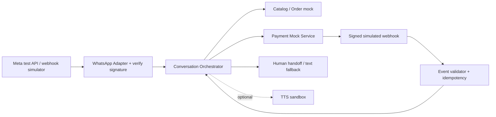

# HelpUS Zap Pro — Especificação de Implementação Sandbox (Ordem 005)

**Data:** 2026-10-31  
**Status:** Para execução técnica local pelo Antigravity e revisão pelo ChatGPT no GitHub  
**Parent issue:** https://github.com/HelpUSA/hub/issues/8  
**Produto:** MVP sintético; **não autorizado para produção, clientes reais ou cobranças reais**.

## 1. Contexto e validação de evidências
O relatório da Ordem 003 do Antigravity descreve: dois motores WhatsApp locais (Meta Cloud API e Baileys), state machine de seis estados, frontend PIX sem backend e teste Edge-TTS de 480 ms. O relatório da Ordem 004 descreve ajuste de `task_completed` para `DELIVERED_TO_AGENT` no consumidor local. Estas informações são declarações do executor local até entrega de código, SHAs, teste e PR; não equivalem a homologação de segurança, conformidade, licença ou desempenho.

## 2. Limites do escopo e dependências
- **Transporte:** usar Meta WhatsApp Cloud API **test numbers** oficiais ou simulador de webhook local. Não usar contas WhatsApp reais com Baileys, mesmo em piloto, antes de revisão legal/compliance e aprovação humana. Bibliotecas não oficiais não são a estratégia de lançamento.
- **Backend de pagamento:** MOCK determinístico (sem banco, chave, QR ou PSP reais) para simular pendente, pago, expirado, cancelado, callback duplicado e inválido. A implementação real de PIX é outro gate, após escolha do PSP.
- **IA:** somente catálogo/teste e chamada de ferramentas limitadas. Saídas do LLM **não** criam pagamento, não definem preço e não habilitam transições administrativas.
- **Voz:** opcional, com fallback texto; produção bloqueada até análise do serviço de TTS, proteção do endpoint e dos direitos de uso comercial.

## 3. Topologia lógica

## 4. Identidade e tenant
`tenant_id` deve ser obtido de autenticação confiável associada à conta/canal, não de mensagem enviada pelo usuário ou saída de IA. Toda consulta/alteração usa `tenant_id` e `conversation_id`. Em sandbox, dois tenants sintéticos A e B são obrigatórios. Eventos com conta ou recurso de outro tenant são rejeitados e auditados.

## 5. Contratos indicativos (versionar formalmente em OpenAPI antes de integrar)
- `POST /api/v1/webhooks/whatsapp`: validar assinatura, timestamp e nonce, deduplicar evento externo; resposta idempotente.
- `POST /api/v1/sandbox/orders`: criar pedido com catálogo/estoque simulados, `idempotency_key` e preço calculado no servidor.
- `POST /api/v1/sandbox/payments`: gerar cobrança **fake** para pedido autorizado; retornar status `PENDING`.
- `POST /api/v1/sandbox/payments/events`: receber callback de simulador; verificar assinatura/secret fake e transição válida.
- `GET /api/v1/sandbox/orders/{id}`: retornar status apenas para tenant autorizado.

Nomes de rotas são proposta, não indicação de endpoints já implementados.

## 6. Máquina de estados
Fluxo recomendado: `IDLE → TRIAGEM → ATENDIMENTO → PEDIDO → AGUARDANDO_PIX → PEDIDO_PAGO`. **Adicionar explicitamente** `CANCELADO`, `EXPIRADO`, `ERRO` e `HANDOFF_HUMANO` e transições reversíveis quando apropriado. `PEDIDO_PAGO` exige evento verificado pelo backend, nunca texto do usuário ou LLM. Definir TTL de carrinho, preço e cobrança, retries seguros e controle concorrente.

## 7. Segurança e testes necessários
- HMAC Meta sobre corpo bruto; tokens nunca em logs; webhook assinado inválido deve dar erro sem alterar estado.
- Testes de isolamento tenant A↔B para sessões, catálogo, pedidos, mídias e credenciais.
- Testes de webhook duplicado, fora de ordem, falso, com replay e timeout; processamento idempotente por `message_id`/event ID.
- Testes de concorrência, crash/restart, persistência adequada ao sandbox, checkout sem pagamento, expiração, falha de IA, ausência de TTS e handoff humano.
- Controles de auth, rate limit, tamanho de payload, CORS restrito e redaction de dados pessoais em logs.
- Negative cases: mensagem 'já paguei' não conclui pedido; output LLM não define preço; token de tenant A não enxerga B.
- Testes unitários/integrados no CI; PRs Draft sem merge antes dos gates.

## 8. Critérios de aceite e evidências
1. Código de cada módulo em branch separada e PR Draft com risco, impacto e rollback.
2. Diagrama de fluxo, OpenAPI, `env.example` sem segredo, suite automatizada, fixtures sintéticos e README de execução reproduzível.
3. Reportar commit SHA e logs sanitizados de `npm test`/equivalentes, testes positivos/negativos, e execução E2E simulada.
4. Não reportar como 'homologado' somente pela existência do `server.js` ou por um teste único de TTS.
5. G2 (sandbox) concluído somente após revisão ChatGPT + evidências Antigravity. G3/G4 exigem autorização humana explícita.

## 9. Sequência recomendada
- **P0-A:** contratos e testes de entrada Meta / simulador + modelo de tenant, [helpus-ai #5](https://github.com/HelpUSA/helpus-ai/issues/5).
- **P0-B:** orquestrador de estados, storage e invariantes, [helpus-ai #6](https://github.com/HelpUSA/helpus-ai/issues/6).
- **P0-C:** mock de pagamento e webhook verificado, [helpus-pay #1](https://github.com/HelpUSA/helpus-pay/issues/1).
- **P1:** fluxo E2E e documentação de custos, [hub #7](https://github.com/HelpUSA/hub/issues/7).
- **Opcional:** adaptação TTS após segurança/licenciamento, [helpus-voice #1](https://github.com/HelpUSA/helpus-voice/issues/1).

## 10. Fontes de conformidade para verificação
- Documentação oficial WhatsApp para números de teste, webhooks, consentimento e políticas: https://whatsappbusiness.com/developers/developer-hub/
- Exemplo de verificação HMAC em webhook oficial: https://whatsapp.github.io/WhatsApp-Nodejs-SDK/api-reference/webhooks/start/
- Condições do produto Microsoft TTS: https://www.microsoft.com/licensing/terms/product/MicrosoftAzure/MCA

**Governança:** ChatGPT cria e revisa o backlog/documentos no GitHub; Antigravity implementa e testa localmente. Entrega por AI Bridge requer ACK de transporte separado de execução comprovada e verificada.
